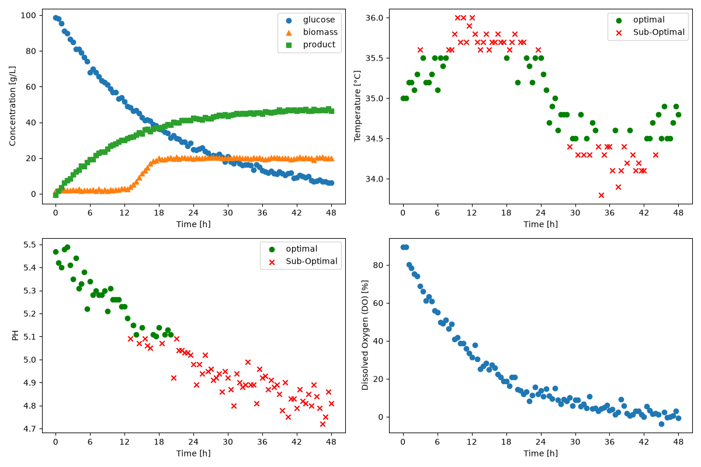

# Fermentation Bioprocess Monitor
A python tool which analyzes batch fermentation data and generates process plots and tables
### Overview
The goal of this project is to automate batch fermentation analysis, specifically evaluating whether the temperature or pH are within their operating ranges.
This program generates a plot and table to display the results
### Features
Class BioprocessMonitor is a class that:
- Batch extract from a fermentation dataset.
- Identifies if temperature and pH measurements are within acceptable operating ranges.
- Generates and exports dashboard figures (graphs).
- Generates and exports batch-level summary tables.
### Technologies Used
- Python 3.14.7
- pandas 3.0.5
- Matplotlib 3.11.0
### Code Design
Before you begin, load your dataset under '*\datasets\dataset_fermentation.csv*', replacing the current dataset.

Run 'main.py' to  analyze your fermentation dataset. You can view your results under '*\figures*' and '*\tables*'

The logic is as follows:
1. Loads the dataset
2. Finds the number of batches
3. Extracts each batch one at a time
4. Verifies pH and Temperature against the operating limits
5. Generates and saves dashboards for each batch (as png)
6. Calculates the batch-level performance information
7. Generates and saves a summary table (as csv)

### Dashboard
Example results for Batch 1 Mode B

The top left plot displays a line graph comparing glucose, biomass, and product concentrations overtime. 
The top right plot displays a scatter plot, where the green circles represent measurements taken within the acceptable temperature range; red x markers represent measurements outside the temperature range
The bottom left plot displays the pH measurement over time, where like the top right plot, green circles represent measurements taken within the acceptable temperature range; red x markers represent measurements outside the temperature range
The bottom right plot displays the dissolved oxygen concentration throughout the batch

### Summary Table
Example table summarizes the fermentation batches under mode A's operating limits.
|batch_id|ph_optimal_percent|temperature_optimal_percent|C_product_g_L^-1_final|
|--------|------------------|---------------------------|----------------------|
|1       |93.81             |97.94                      |46.5                  |
|2       |96.69             |97.52                      |50.8                  |
|3       |95.89             |93.15                      |44.6                  |
|4       |100.0             |96.47                      |48.6                  |
|5       |48.62             |99.08                      |24.7                  |

